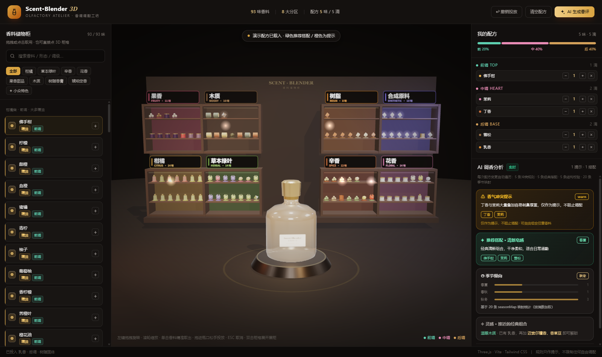
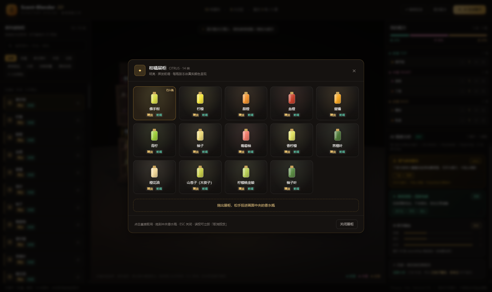
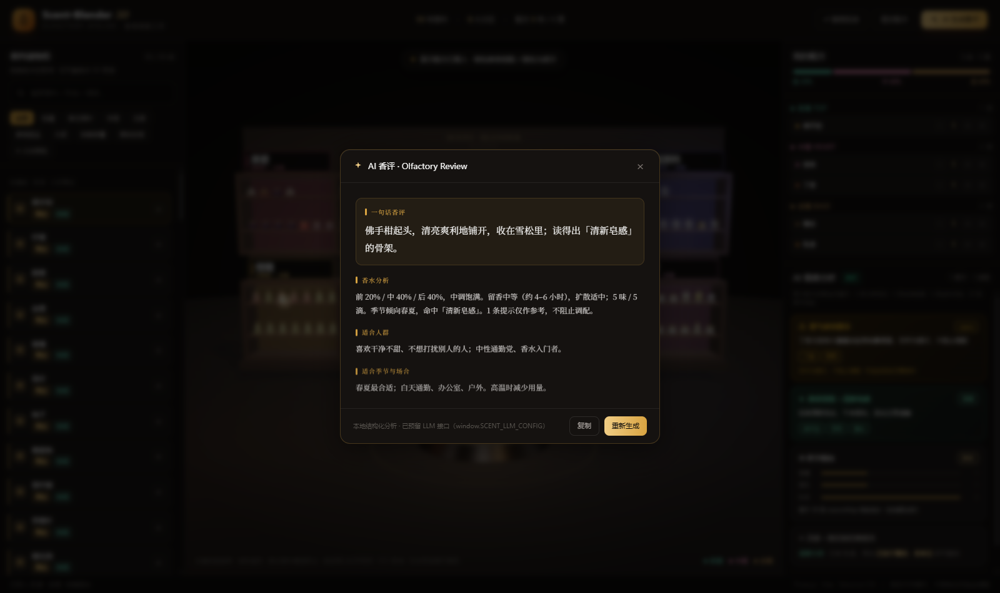

# Scent·Blender 3D

> 打开柜子，拿出一瓶香料，拖进香水瓶 —— 一个可交互的 3D 香调调配模拟器。
> **Vibe Coding 个人项目**：从产品想法到可演示成品，由我独立定义需求、体验与 AI 规则策略，AI 辅助编码完成实现。



**立即体验**
- 或本地运行：`npm install && npm run dev` → <http://localhost:5173/>
- 生成离线单文件版：`npm run build && npm run build:standalone`，再双击生成的 `Scent-Blender-3D.html`。
- 在线版：推送后由 GitHub Pages 自动部署，访问 <https://xinduo682-create.github.io/scent-blender-3d/>
- GitHub 源码：<https://github.com/xinduo682-create/scent-blender-3d>

---

## 项目速览

| 维度 | 内容 |
| --- | --- |
| 项目性质 | Vibe Coding 个人项目 · 独立完成产品定义 / 体验设计 / 交付 · 2026.11 |
| 用户问题 | 香水的「前 / 中 / 后调」与气味冲突很抽象，现有工具多是表格和文字说明，用户难以建立直觉 |
| 核心链路 | 双击展柜 → 取出香料 → 拖入香水瓶 → 实时分析 → 结构化香评 |
| 内容规模 | 125 味香料、8 大分区、前 / 中 / 后调三层结构、自动分类搭配规则 |
| 关键决策 | 规则只提示不拦截；三层防误触撤销；逐味本体配色；香评简洁结构化 |
| 交付物 | 可双击的离线单文件版 + 在线 Demo + 产品 README + 实拍截图 |
| 实现方式 | AI 辅助编码 · Three.js + Vite + Tailwind CSS · 纯前端无后端 |

一句话概括：**用 Vibe Coding 把一份调香规则库，做成了一个带实时反馈、人人都能上手试的 3D 工坊。**

## 产品思考

**为什么做**：香水的「前 / 中 / 后调」和气味冲突是抽象概念，用户很难只靠表格建立直觉。我把它们变成可操作的物件 —— 能打开的柜子、能拿起的香料、会随配方变化的香水瓶。

**怎么定规则边界**：调香规则最容易被做成「系统替用户做决定」。我明确限定为**只提示、不拦截** —— 橙色警告、绿色推荐、结构建议都只以提示框出现，用户可以任意组合，创作权始终留在人手里。

**怎么取舍（按体验反馈迭代 3 轮）**：

| 发现的问题 | 产品决策 |
| --- | --- |
| 「点一下就加入」容易误触 | 改为「先取出拿在手上、拖到瓶口才投放」，并补 ESC / 操作条 / Ctrl+Z 三层撤销 |
| 香料分区与瓶名难辨 | 改为 360° 环绕工坊、疏朗大瓶陈列和高对比名称牌 |
| 按分区统一上色，血橙和薄荷长一个样 | 改为逐味按本体特征配色 |
| 初版香评文艺但冗长 | 收敛成四块结构化输出，明确回答「适合谁、适合什么季节」 |

**怎么交付**：每轮迭代都保证可运行、可演示；最终做出不需要安装任何环境的离线单文件版，让 HR / 面试官 30 秒就能上手体验。

## 效果

| 分区展柜（双击柜格展开） | 结构化香评 |
| --- | --- |
|  |  |

展柜中每个瓶子按香料**本体真实颜色**呈现：血橙深红橙、青柠青绿、薄荷薄荷绿、黑加仑深紫黑、乳香乳金、海盐 / 臭氧淡蓝白、巧克力深褐 —— 93 味逐一配色，而非按分区统一上色。

## 功能一览

**3D 工坊**
- 从地面延伸到天花板的 360° 弧形陈列墙，柜组之间保留连续空层板；中央调香台可环视，125 味香材按 9 种形态生成放大模型
- 中央玻璃香水瓶：`LatheGeometry` 瓶身 + 透射玻璃材质，液面高度、混合色、瓶内粒子随配方实时变化
- `RoomEnvironment` PMREM 环境光照、ACES 色调映射、阴影、缓动漂浮与飞入粒子动画
- 拖动空白区域顺滑环视 / 滚轮缩放；右键香料显示介绍与属性，拖动香材投入中央香水瓶
- 配方侧栏可点击或拖动把手收起；新增香材自动获得瓶身、分区、调级与季节提示
- 象牙白石材、香槟金层边、竖向细纹与层板暖光；抛光大理石地面带实时场景反射，中央香水瓶有聚焦轮廓光，精油瓶有可见液芯

**交互**
- **拖动画面空白处** → 环绕查看整间香料工坊；滚轮缩放观察瓶身
- **单击 3D 香料** → 精准取出并「拿在手上」，此时**不会误投**；拖到瓶口松手或再次点击才投放
- 侧栏卡片 / 展柜卡片支持 HTML5 拖拽投入，也支持点击 `+` 快速加入
- 配方按前 / 中 / 后调三栏展示，可增减滴数、单条移除、一键清空

**防误触与撤销**
- 拖拽中按 `ESC`、在瓶区外松手、指针操作被系统中断时都会取消并恢复镜头
- 每次投放后 6 秒内可点「取消投放」撤回（新增的整条移除、已有的减一滴）
- 顶栏「撤销投放」按钮 + `Ctrl/⌘ + Z`

**本地规则分析与香评**
- 实时遍历冲突规则、经典搭配、结构平衡（单一调 / 前调过重 / 后调过重）与季节倾向
- 命中冲突与结构问题 → 橙色提示框；命中经典搭配 → 绿色提示框；同时弹出 toast；附带「接近解锁」的灵感推荐
- **结构化香评**：一句话总评 / 香水分析（占比、留香、扩散、季节、命中搭配）/ 适合人群 / 适合季节与场合，约 200 字
- 香评根据配方本地生成；留香和扩散只给定性倾向，不承诺具体小时数
- 可选同源服务端代理：`window.SCENT_LLM_CONFIG = { endpoint, model }`；浏览器只请求同源 endpoint，不接收、不发送 API key。真实模型密钥必须保存在服务端，纯静态部署默认使用本地分析
- 配方自动保存在当前浏览器；可从配方栏导出 JSON 或导入此前导出的配方

## 快速开始

要求 Node.js 18+（已在 Node 22 验证）。

```bash
npm install
npm run dev              # 开发服务器 http://localhost:5173/
npm run build            # 生产构建 → dist/
npm run build:standalone # 由 dist/ 生成可双击的单文件 HTML
```

| URL 参数 | 作用 |
| --- | --- |
| `?demo=1` | 预载一份同时触发橙色提示与绿色推荐的演示配方 |
| `?case=citrus` | 直接展开柑橘展柜（换成任意分区 key） |
| `?review=1` | 直接打开香评弹窗 |

配方保存在浏览器本地存储中。要迁移或备份配方，使用配方栏的「导出 / 导入」JSON 按钮。

分区 key：`citrus` · `herbal` · `spice` · `floral` · `fruity` · `woody` · `resin` · `synthetic`

## 操作速查

| 操作 | 结果 |
| --- | --- |
| 双击 3D 柜格 | 展开该分区展柜 |
| 单击 3D 香料 | 取出并手持（不投放） |
| 手持后移到瓶口松手 / 点击 | 投入香水瓶 |
| 拖拽侧栏或展柜卡片到瓶子 | 直接投入 |
| `ESC` | 取消手持 / 关闭弹窗 |
| `Ctrl/⌘ + Z` | 撤销上一次投放 |
| 配方栏「导出 / 导入」 | 备份、迁移配方 JSON |
| 拖动两侧把手 | 收起侧栏；向内拖动重新展开 |
| 手机顶部工作区切换 | 在香料库、3D 工坊与配方间切换 |

## 附：技术实现备注

<details>
<summary>展开查看（面向工程师，非技术读者可跳过）</summary>

**3D 场景与性能**
- 93 个香料模型复用 9 类共享几何体与按「分区 + 形态 + 色阶」缓存的材质，避免逐个创建 GPU 资源
- 玻璃瓶使用 `MeshPhysicalMaterial` 的 `transmission / thickness / ior / attenuationColor`，配合 `RoomEnvironment` 生成的环境贴图；小模型改用透明 + 清漆模拟玻璃，避免大量透射材质触发额外渲染 pass
- 分区标牌与瓶身标签由 `CanvasTexture` 运行时生成，项目**不含任何外部图片或字体文件**

**精准拾取与手持状态机**（`src/scene3d.js`）
- `Raycaster` 命中单个香料 mesh → 单击进入 `held` 状态，生成跟随指针的发光精灵
- 命中香料时 `setPointerCapture` 并临时禁用 `OrbitControls`；用 window 级 `pointermove/up` 保证指针移出 canvas 后仍能完成投放
- `held.armed` 需先移动超过 4px 才允许松手投放，杜绝「点一下就自动投进去」的误触
- 松手位置通过瓶子 3D 包围盒投影得到的屏幕矩形判定，与相机旋转 / 缩放联动
- `pointercancel` 与异常丢失指针捕获都会复位手持状态；瓶区外松手会取消投放

**撤销栈**（`src/main.js`）
- 每次投放记录 `{ id, wasNew, prevDrops }`，撤销时精确还原；`remove / changeDrops / reset` 会清空栈，避免撤销到不一致状态

**规则引擎**（`src/analyzer.js` + `src/data.js`）
- 纯函数分析器，只产出提示信息，不返回任何拦截指令
- 规则库用简称、清单用全称：通过 `canonName()` 去括号 + 别名表解决「檀香 → 迈索尔檀香」「沉香（乌木）→ 沉香」「岩兰草（香根草）→ 岩兰草」「龙涎香醚（Ambroxan）→ 龙涎香醚」，同时精确区分「橙花 / 橙花油」「紫罗兰 / 紫罗兰叶」避免串味
- 命中经典搭配时，季节建议优先采用规则库标注值
- 留香与扩散只输出定性倾向；规则配方不会伪装成真实模型的精确预测

**配方保存与模型接入**
- 配方每次变更后写入浏览器 `localStorage`；JSON 导入会校验香料 ID、滴数范围和重复项
- 纯静态页面不会保存或发送 API key；如需真实模型，`SCENT_LLM_CONFIG.endpoint` 必须指向同源服务端代理，且请求禁止跨域与重定向

**构建与部署**
- `vite.config.js` 在构建时使用相对 `base`，保证 GitHub Pages 子路径 `/<repo>/` 下资源正常加载
- `scripts/build-standalone.mjs` 把 CSS / JS 内联进单个 HTML（内联时用函数式 `String.replace`，避免压缩代码中的 `$&` 被误当作替换模式）
- `.github/workflows/deploy.yml` 在 push 到 `main` 时自动 `npm ci → build → deploy-pages`

</details>

## 目录结构

```
├── index.html                  # 页面骨架与三栏工作台
├── src/
│   ├── main.js                 # 状态编排、撤销栈、各模块接线
│   ├── data.js                 # 93 味香料、精确色卡、规则 JSON、名称归一化
│   ├── analyzer.js             # 规则遍历 + 结构化香评 + 同源代理接口
│   ├── scene3d.js              # Three.js 场景、柜体、玻璃瓶、拾取与拖拽
│   ├── ui.js                   # 清单 / 配方导入导出 / 展柜 / 提示 / 香评渲染
│   └── style.css               # Tailwind + 组件样式
├── scripts/build-standalone.mjs
├── docs/screenshots/           # README 效果图
├── .github/workflows/deploy.yml
├── Scent-Blender-3D.html       # build:standalone 生成的离线单文件版
└── dist/                       # 构建产物（gitignore）
```

## 数据与规则

香材清单与香调规则库内置于 `src/data.js`，随项目一起版本化，不依赖任何外部 API。规则库为演示用途的经验性建议，不构成专业调香结论；所有提示都明示「仅作为提示，不阻止调配」。

## 已知限制与后续规划

- 无 GPU 的软件渲染环境下玻璃透射效果会打折（真实浏览器表现完整）
- 窄屏为堆叠布局，3D 操作以触摸旋转为主
- 真实模型接入需要部署同源服务端代理；静态页面不会保存或发送模型密钥
- 自动保存使用浏览器本地存储；清除浏览器数据会清除本机配方，请用 JSON 导出备份
- 后续可考虑：分享链接、留香曲线可视化、多语言、香料形态的 glTF 精细模型

## 部署到 GitHub Pages

1. 推送仓库后进入 **Settings → Pages → Build and deployment**，Source 选择 **GitHub Actions**
2. 每次 push 到 `main` 会触发 `deploy.yml` 自动构建部署
3. 在仓库 **About** 中把 Website 填为 Pages 地址，并加上 topics：`threejs` `webgl` `vite` `tailwindcss` `frontend` `3d` `perfumery`

## License

个人作品集项目，代码用于学习与展示。如需开源许可，请在仓库根目录自行添加 `LICENSE`（作品集项目通常选 MIT）。
